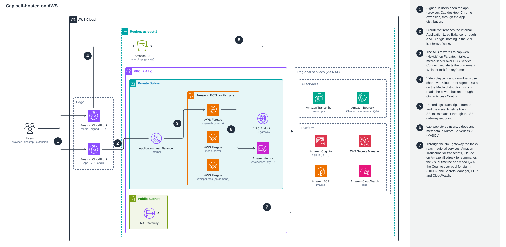
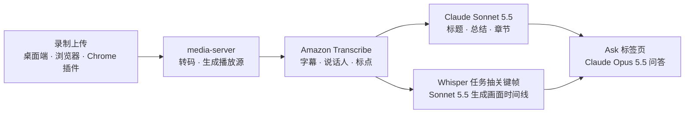

# Cap Self-Hosted on AWS

> 把开源录屏工具 [Cap](https://github.com/CapSoftware/Cap)(Loom 的开源替代)完整部署到**你自己的 AWS 账号**,
> 并加上 Amazon Transcribe 转写、Claude 总结和**基于视频内容的问答**。
>
> *A self-hosting branch of [CapSoftware/Cap](https://github.com/CapSoftware/Cap): one-command CDK deploy to your
> own AWS account, Amazon Transcribe captions, and Claude on Amazon Bedrock for summaries and video Q&A.*

录屏上传、播放、分享、评论这些功能沿用上游 Cap;这个分支解决的是**自建部署**和**录制之后的理解**:
一段一小时的会议录完,几分钟内就有带说话人和标点的字幕、AI 总结和章节,还可以直接问"这次会议定了什么"、
"演示里设置页上有哪些选项",回答里的时间戳点一下就跳到视频对应位置。

## 功能

| | 说明 |
|---|---|
| **一条命令部署** | `./infra-aws/scripts/deploy.sh` 从空账号部署到可用实例,之后每次更新也是同一条命令,见 [`infra-aws/DEPLOY.md`](infra-aws/DEPLOY.md) |
| **Amazon Transcribe 转写** | 中英自动识别、说话人识别、完整标点;1 小时 45 分钟的录制约 9 分钟出字幕。自建 Whisper 作回退 |
| **Claude 总结与章节** | Amazon Bedrock 上的 Claude Sonnet 5.5 生成标题、总结和章节 |
| **视频问答(Ask 标签页)** | Claude Opus 5.5 基于**完整字幕 + 画面时间线**回答,每个结论带可点击的 `[mm:ss]`;需要看清画面细节时自己调用 `look_at` 查看关键帧 |
| **画面时间线** | 按画面变化抽关键帧,Sonnet 5.5 逐段描述画面并**原样照抄屏幕文字**(幻灯片、代码、报错、界面数值),让问答也能回答"屏幕上显示了什么" |
| **必须登录才能观看** | 整个实例只对登录用户开放,包括设成"公开"的视频;链接预览、oEmbed、公开合集也一并关闭 |
| **Cognito 登录** | 管理员建号,通过 OIDC 登录;支持上游新增的 Passkey |

## 架构



要点:

- **VPC 里没有任何对公网开放的入口。** 站点走 CloudFront → **VPC origin** → 内部 ALB;公有子网里只有一个 NAT 网关。
- **录像桶是私有的。** 播放和下载用 CloudFront **签名 URL**(1 小时有效),CloudFront 通过 Origin Access Control 读桶;
  ECS 任务经 S3 网关端点访问,不走 NAT。
- **常驻的只有两个 Fargate 服务**:`cap-web`(Next.js)和 `media-server`,通过 ECS Service Connect 互访。
  Whisper 是**按需启动**的一次性 Fargate 任务,只在抽关键帧(或回退转写)时运行。
- **数据库**是 Aurora Serverless v2(MySQL,0.5–4 ACU);所有密钥在 Secrets Manager,镜像在 ECR,日志在 CloudWatch。
- 架构图是 draw.io 可编辑的 SVG:直接拖进 [diagrams.net](https://app.diagrams.net) 就能改。

### 从录制到问答



问答时,整份带时间戳的字幕、画面时间线、总结和章节作为一个**带缓存点**的上下文交给模型;需要看清画面细节时,
模型会调用 `look_at` 直接查看那段时间的关键帧。追问只按缓存读计费
(约为首次的十分之一)。画面时间线在转写流程开启 AI 生成时随之生成,否则(以及更早的视频)在第一次被提问时自动补上,
补上之前的回答只基于字幕。

## 快速开始

前提:一个 AWS 账号(区域 **us-east-1**)、在 Bedrock 里开通 Claude Sonnet 5.5 和 Opus 5.5、
一台装了 Docker / Node 24 / Bun / AWS CLI 的构建机。

```bash
git clone https://github.com/IanLiYi1996/cap-selfhost.git && cd cap-selfhost
./infra-aws/scripts/deploy.sh --admin-email you@example.com
```

首次约 1 小时,完成后打印站点地址和管理员密码。加 `--plan` 可以只看会做什么、不做改动。
完整步骤、添加用户、客户端设置、日常更新和常见问题见 **[`infra-aws/DEPLOY.md`](infra-aws/DEPLOY.md)**。

## 费用

粗略估算,以账单为准:

- **固定约 $200/月起**:NAT 网关、Aurora Serverless v2 最小容量、两个常驻 Fargate 服务、内部 ALB,
  外加少量 CloudFront / S3 / Secrets Manager。
- **按用量**:Amazon Transcribe 约 $1.44/小时音频;画面时间线 1 小时录制约 $0.1–0.3;
  问答首问约 $0.2、追问约 $0.01(按 Anthropic 官方价估算,Bedrock 单独计价)。

## 目前不支持

- **邮件不发送**:没有配置发信服务,邮箱验证码登录、评论通知、邀请邮件都不可用。
- **iOS App**:商店版的服务器地址写死为 cap.so,手机上直接用浏览器打开分享页。
- **实时字幕**(边录边出):依赖 AssemblyAI 的流式接口,本分支只做录制后的批量转写。
- **用户自配的 S3 桶**:可以存视频,但不会转写,也没有画面时间线。
- **中英混说时的英文术语**:Transcribe 对 Agent、GraphRAG 这类英文词识别偏弱(纯中文术语反而比 Whisper 准)。

## 和上游的差异

本仓库基于上游提交 `5bc15a52b`(2026-11-23)。新增的部分集中在这些目录:

| 路径 | 内容 |
|---|---|
| `infra-aws/` | CDK 栈(网络、存储、数据库、计算、前门、Cognito、Whisper)、`deploy.sh`、`DEPLOY.md` |
| `apps/whisper-server/` | 按需运行的 Whisper 任务:回退转写、说话人识别、繁转简、抽关键帧 |
| `apps/web/lib/aws-transcribe.ts` | Amazon Transcribe 转写后端 |
| `apps/web/lib/video-qa/` · `apps/web/workflows/visual-timeline.ts` | 视频问答与画面时间线 |
| `apps/web/app/api/videos/[videoId]/ask/` · `apps/web/app/s/[videoId]/_components/tabs/Ask.tsx` | 问答接口和 Ask 标签页 |
| `apps/web/lib/sign-in-required.ts` | 实例级"必须登录才能观看" |

对上游文件的改动(转写门控、权限策略、限流、OG 图等),以及每次合并上游新版本后必须检查的地方,
都记录在 [`design/notes/aws-deployment-runbook.md`](design/notes/aws-deployment-runbook.md) 的「同步上游」一节。
设计文档在 [`design/superpowers/specs/`](design/superpowers/specs/)。

上游 Cap 本身的介绍、桌面端和本地开发说明,见上游的 [README](https://github.com/CapSoftware/Cap#readme)。

## 许可证

沿用上游:除 `cap-camera*` 和 `scap-*` 系列 crate 为 MIT 外,其余代码均为 **AGPLv3**,见 [`LICENSE`](LICENSE)。
如果把部署出来的实例提供给组织以外的人使用,需要向他们提供修改后的源代码。
